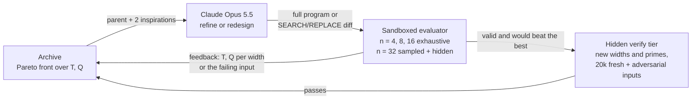
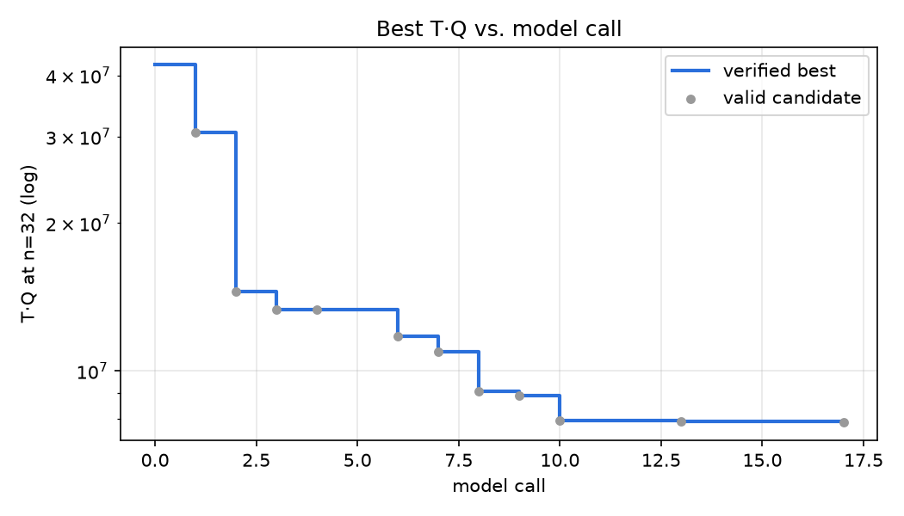
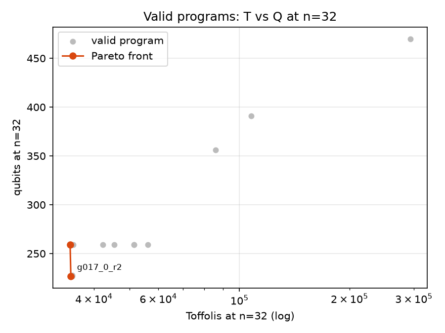
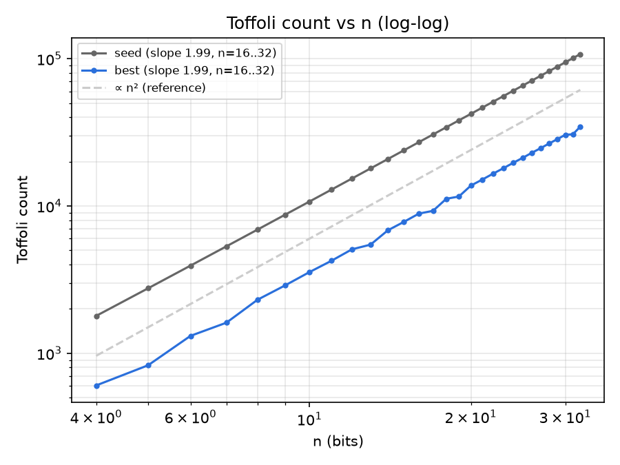

# Shor's Edge

**Shor's Edge: 5.36× lower T·Q than a textbook binary-Euclid baseline for reversible modular inversion at
n = 32: 107,520 → 34,572 Toffolis and 391 → 227 qubits, found in 17 Claude Opus 5.5 calls.**

An evolutionary loop in which Claude proposes width-generic reversible circuits (X / CNOT /
Toffoli) for computing a⁻¹ mod p, and a strict, sandboxed evaluator scores them by
T·Q (Toffoli count × qubits). A hidden verify tier and an independent Qiskit/Aer cross-check
guard against circuits that only look correct.

By [Yusuf Marwat](https://github.com/smarwat). Inspired by Anthropic's
[*Designing more efficient quantum circuits with Claude*](https://www.anthropic.com/research/designing-efficient-quantum-circuits)
(October 2026). This project is an independent, small-scale exploration, not affiliated with or a
replication of that work.

[](https://github.com/smarwat/shors-edge/actions/workflows/ci.yml)

## Why it matters

Shor's algorithm breaks elliptic-curve cryptography by running elliptic-curve point additions
as reversible quantum circuits, and each point addition needs modular inversions, which are by
far its most expensive part. Roetteler, Naehrig, Svore & Lauter (2017) call modular inversion
"by far the most costly operation" in the affine group law. Cheaper reversible inversion
directly lowers resource estimates for attacking ECC. This project is a small-scale (n ≤ 32)
testbed for finding such circuits with an LLM in the loop.

## How it works



- A candidate is Python that defines `build_circuit(c, n, p)`. It must work for **any** width n
  and odd prime p < 2ⁿ:
  - the input a must stay unchanged
  - the output register must end holding a⁻¹ mod p
  - every ancilla must return to 0
- Candidates run in a subprocess with restricted builtins and no imports. Only the raw gate
  array comes back. The evaluator re-validates every gate, recounts T and Q, and simulates
  all test inputs at once (bit-sliced) with its own code.
- Score: T·Q at n = 32. Lookup tables can't fit at that width, so only algorithmic
  constructions score.

## Results

| n | p | seed Toffolis | seed qubits | seed T·Q | **best Toffolis** | **best qubits** | **best T·Q** | best Toffoli depth |
|---|---|---|---|---|---|---|---|---|
| 4 | 13 | 1,792 | 55 | 98,560 | 604 | 31 | 18,724 | 432 |
| 8 | 251 | 6,912 | 103 | 711,936 | 2,308 | 59 | 136,172 | 1,562 |
| 16 | 65,521 | 27,136 | 199 | 5,400,064 | 8,876 | 115 | 1,020,740 | 5,860 |
| 32 | 4,294,967,291 | 107,520 | 391 | 42,040,320 | **34,572** | **227** | **7,847,844** | 22,450 |

**Growth:**
- Seed: T = 104n² + 32n and Q = 12n + 7, both exact.
- Best (`g017_0_r2`): Q = 7n + 3 exactly, and T ≈ 32n². Its log-log slope over n = 16..32 is
  1.99, but its cost also depends on p's bit pattern, so a single quadratic fits only to within
  18% (see RESULTS.md).
- Both are Θ(n²) in Toffolis and Θ(n) in qubits.

T-count at n = 32 for the best: 242,004 at 7 T per Toffoli, or 138,288 at 4 T per Toffoli
(AND gates with measurement-based uncomputation).

| | | |
|---|---|---|
|  |  |  |

Full, generated report: **[results/RESULTS.md](results/RESULTS.md)**. Circuits as OpenQASM 2:
`results/qasm/`.

## What the AI discovered

The winner's lineage, one step per row (T, Q at n = 32). Each sentence is a plain summary of
the model's own explanation and the code diff.

| step | program | mode | T | Q | idea |
|---|---|---|---|---|---|
| 0 | seed | – | 107,520 | 391 | Textbook baseline: binary extended Euclid with modular halving, two stored history bits per step, full Bennett reversal. |
| 1 | g001_0 | refine | 86,144 | 356 | Keep u odd so the register being operated on is always v. The swap is never undone, the "v odd" bit becomes a CNOT copy, and the input register doubles as the initial v. |
| 2 | g002_0_r1 | redesign | 56,104 | 259 | Switch to Kaliski-style integer coefficients, so there is no modular arithmetic in the loop. Store one history bit per step and recover the swap bit from coefficient parity. Fix the 2ᵏ factor once at the end. |
| 3 | g003_0_r2 | refine | 51,454 | 259 | Shrink coefficient swaps and additions to the bits that can be non-zero in early iterations. |
| 4 | g006_0_r2 | redesign | 45,502 | 259 | Let u and v shrink with the GCD: u·v at least halves each step, so only the low bits need operating on. |
| 5 | g007_0_r2 | refine | 42,336 | 259 | Keep the coefficients in the same persistent swapped orientation as u, v: one coefficient swap per step instead of two. |
| 6 | g008_0_r2 | redesign | 35,056 | 259 | Replace the bit-serial 2ᵏ correction with a radix-2ʳ version driven by a precomputed table. |
| 7 | g009_0_r2 | refine | 34,416 | 259 | Use parity facts (both values are odd whenever a subtraction fires) to drop bit 0 from the comparator and subtractor. |
| 8 | g010_0_r2 | redesign | 34,820 | 228 | Park late history bits in input qubits that are provably zero by then, and take scratch space from provably-zero bits. This trades a few Toffolis for many fewer qubits. |
| 9 | g013_0_r2 | refine | 34,820 | 227 | Clear iteration 0's history bit immediately, so iterations 0 and 1 share one qubit. |
| 10 | g017_0_r2 | refine | 34,572 | 227 | Tighten the coefficient width bound by one bit, using the invariant V·CV + U·CU = p. |

The model predicted its own T and Q by hand in each reply, without running anything, and was
exact on the last two steps.

## Verification: what each check covers

1. **Normal tier** (every candidate, `evaluator.py`):
   - n = 4, 8 and 16: every input (12, 250 and 65,520 inputs).
   - n = 32: edge cases (1, 2, 3, p−1, p−2, (p+1)/2, every power of two and every 2ᵏ−1 below p),
     256 public random inputs and 256 hidden random inputs.
   - Checks input preserved, output = a⁻¹ mod p, and all ancillas 0.
   - A failure names the input, unless it is a hidden input.
2. **Hidden verify tier** (only for would-be new bests):
   - n = 32 on 20,000 fresh random inputs plus edge cases and **adversarial** inputs. These are
     the inputs needing the most loop iterations, found by hill-climbing under four step-count
     models (binary Euclid, Kaliski, Bernstein-Yang divsteps, Stein's binary GCD). Random
     sampling misses these worst cases: a divsteps circuit cut to fewer iterations only at
     n = 32 passes the normal tier and fails here (that case is a test).
   - The same generator at **hidden widths and primes** the model never sees, which catches
     anything tuned to n = 32.
   - The regenerated circuit must have the scored T and Q.
   - The model only ever sees `failed verification`.
3. **Re-verification with fresh hidden values.** The original hidden seeds, widths and primes
   had been committed to git, so they were rotated to new secret values in an untracked file.
   The winner was re-checked against them: valid in the normal tier, and passed the verify tier
   over 26,474 inputs on 4 targets (2 new hidden widths and a new 32-bit prime). So it was not
   tuned to the old hidden set.
4. **Independent cross-check with Qiskit 2.6 / Aer 0.18** (`analysis/independent_verify.py`,
   shares no code with the evaluator). The circuit is rebuilt with a separate builder, exported to
   OpenQASM 2, reloaded, and simulated with Aer's `matrix_product_state` method.
   - **Basis states:** every input at n = 4 and 8; at n = 16 and 32, 200 random inputs plus edge
     and adversarial inputs (285 and 318 inputs). **0 failures.** T and Q match the evaluator at
     every width.
   - **Superposition test:** Hadamards on the input register, then exact probabilities and
     ⟨ΣZ⟩ over all ancillas, plus 4,096 shots. This shows every ancilla returns to |0⟩ with
     probability 1, every (input, output) pair is correct, and the registers are not entangled
     with the ancillas.
     - n = 4: passed, both with Hadamards and with a superposition over valid inputs only.
     - n = 8: passed with Hadamards. Probability exactly 0.9765625 (= 250/256) on correct pairs, ⟨ΣZ⟩ = 43 of 43 ancillas, 0 bad shots (63 min of simulation).
   - **Harness problems found along the way** (full disclosure in RESULTS.md): under the MPS
     method in Aer 0.18.0, `save_amplitudes` and `initialize` gave wrong results, which a small
     comparison against the exact statevector method reproduces. The verifier now avoids both
     and self-tests every simulator primitive it uses.

## Comparison with the literature, honestly

The only claim this project makes is against **Häner, Jaques, Naehrig, Roetteler & Soeken
2020**'s low-T-count inversion (arXiv:2001.09580, Table 4). By their fitted formula at n = 32
that design needs 535,757 T and 304 qubits. Our winner needs **242,004 T** at 7 T per Toffoli
(**2.2× lower**; 138,288 T, 3.9× lower, at 4 T per Toffoli) and **227 qubits (77 fewer)**.

Why other comparisons aren't meaningful: our **unevolved seed** already has a lower cost than
the formulas for Roetteler et al. 2017 (Table 1: 32n² log₂ n Toffolis, leading order only) and
for Häner et al.'s low-width and low-depth variants. Those gaps reflect accounting and adder
choices (e.g. qubit-minimising incrementer adders), not the search. Häner et al.'s low-T variant
is the one the seed does *not* beat (752,640 T for the seed), so it's the one comparison where
the evolved circuit's gain is informative.

**Caveats:**
- **Different function.** The papers compute the Montgomery-form inverse x⁻¹·2ⁿ mod p; we
  compute the standard inverse, with any 2ᵏ correction counted in our cost.
- **Fitted formulas, not rebuilt circuits.** Their numbers are fitted by the authors from Q#
  resource counts. We evaluated the formulas at n = 32; we did not re-build their circuits.
- **T-count conventions differ.** 7 T per Toffoli is conservative for us. Their counts already
  use 4-T AND gates and 0-T uncomputation, which is why the 4-T figure is also shown.
- **Specialised to p.** Our generator specialises the circuit to the prime p (constants, loop
  bounds). That's normal for ECC, where p is fixed, and their circuits also fold the constant p.
- **Not an established improvement.** Settling it would need their circuits re-built and
  counted under the same accounting.

See the computed comparison table and every accounting difference in
[results/RESULTS.md](results/RESULTS.md).

## Run statistics

- **17 model calls**, all answered by `claude-opus-5-5`:
  - 11 valid
  - 3 duplicates (resubmitted an archived program)
  - 2 wrong answers
  - 1 syntax error
  - none failed hidden verification
- By mode: refine made 6 new bests in 10 calls, redesign 4 in 7.
- Median call time 133 s (mean 209 s, max 1,109 s).
- Notional cost $7.85 total. **Not billed**: the run used a Claude subscription through
  headless Claude Code (`claude -p`), and this is the CLI's reported equivalent price.

## Limitations

- **Toy widths.** n ≤ 32, not the 256-bit fields of real ECC. Growth is measured up to n = 32 only.
- **Reversible arithmetic only.** Toffoli/qubit counts of one primitive, not a full
  fault-tolerant compilation (no Clifford+T synthesis, layout or error-correction overhead).
- **Few calls.** A small number of model calls (17) and a single run, so this is not a
  statistical study of the method.
- **Not a replication.** This is an independent, small-scale exploration inspired by Anthropic's
  [*Designing more efficient quantum circuits with Claude*](https://www.anthropic.com/research/designing-efficient-quantum-circuits),
  not affiliated with or a replication of that work.

## Future work

- **Duplicate resubmissions.** 3 of 17 calls were wasted: in redesign mode the model sometimes
  resubmitted an inspiration verbatim. The fix is a prompt line forbidding resubmission, plus
  showing the parent's own lineage instead of the archive's best.
- **Larger widths.** n = 64 and beyond, with the gate cap and sampling scaled.
- **Other primitives.** Modular multiplication, squaring, and full point addition.

## Reproduce

```bash
python3 -m venv .venv && .venv/bin/pip install -r requirements.txt
python make_hidden_values.py                       # your own secret test values (git-ignored)
.venv/bin/python -m pytest tests -q                # ~75 s, offline
.venv/bin/python orchestrator.py --mock --generations 2
```

**Default backend: your Claude subscription via headless Claude Code.**

```bash
.venv/bin/python orchestrator.py --generations 15 --per-gen 1 --max-calls 15 --effort medium --redesign-prob 0.4
.venv/bin/python orchestrator.py --resume runs/<dir> --generations 5
```

- **CLI version.** Needs **Claude Code ≥ 2.1.280**, the first version that accepts
  `claude-opus-5-5`. The isolation flags were confirmed in 2.1.295 and 2.1.305. At startup the
  client reads `claude --help` and refuses to run if any required flag is missing.
- **Isolation.** Each call runs `claude -p --output-format json --model claude-opus-5-5 --tools ""
  --max-turns 1 --restricted --strict-mcp-config --mcp-config '{"mcpServers":{}}'
  --disable-slash-commands --no-session-persistence`. It runs in an empty temp directory with an
  allowlisted environment (no `ANTHROPIC_*` variables).
- **Why the extra flags.** `--tools ""` alone still loads your MCP connectors.
- **Limits and resume.** Usage limits are detected; the run waits for the reported reset or
  exits cleanly with a `--resume` command.

**Paid API backend** (only ever used when passed explicitly):

```bash
ANTHROPIC_API_KEY=... .venv/bin/python orchestrator.py --backend api --budget-usd 20 --generations 10
```

**Independent verification and report** (manual, about an hour):

```bash
python3 -m venv .venv-verify && .venv-verify/bin/pip install -r requirements-verify.txt
.venv-verify/bin/python analysis/independent_verify.py results/ best=results/best.py
.venv-verify/bin/python analysis/resources.py results/ seed=seeds/binary_euclid.py best=results/best.py
.venv-verify/bin/python analysis/run_analysis.py runs/<dir> results/
.venv-verify/bin/python analysis/make_results.py results/
```

CI runs the tests and a `--mock` run only. See [ARCHITECTURE.md](ARCHITECTURE.md) for the
layout and data flow.

## Credits

- [OpenEvolve](https://github.com/codelion/openevolve), whose evolutionary-coding loop and
  SEARCH/REPLACE diff format this follows.
- Anthropic, [*Designing more efficient quantum circuits with Claude*](https://www.anthropic.com/research/designing-efficient-quantum-circuits)
  (October 2026), which inspired the experiment. This project is an independent, small-scale
  exploration, not affiliated with or a replication of that work.
- The reversible-inversion designs compared against:
  - Roetteler, Naehrig, Svore & Lauter 2017 (arXiv:1706.06752)
  - Häner, Jaques, Naehrig, Roetteler & Soeken 2020 (arXiv:2001.09580)

MIT licensed, © 2026 Yusuf Marwat. See [LICENSE](LICENSE).
